# Bhuvi Naturals – Database Specification

Date: 2026-07-09

Status: Draft for Engineering Alignment

## 1. Design Goals

The database must support a premium direct-to-consumer ecommerce platform for skincare, haircare, and natural soap products. It must be designed for:

- strong transactional integrity for cart, checkout, orders, and payments,
- flexible catalog management for variants and content,
- SEO and CMS support for marketing growth,
- reliable inventory control to avoid overselling,
- auditability for operations and support,
- future expansion into subscriptions, loyalty, and merchandising.

This specification is intentionally business-led first. Every table exists because the business or operations workflow requires it.

---

# 2. Why Every Table Exists

## 2.1 Identity and Access

### users

Why it exists:

- Represents a single identity for customers, admins, and internal users.
- Centralizes auth-related identity data and provides the primary anchor for permissions and order history.

### sessions

Why it exists:

- Stores active authentication sessions securely and allows logout and invalidation.

### accounts

Why it exists:

- Supports OAuth or external auth providers in the future and keeps authentication accounts separate from core user records.

### verification_tokens

Why it exists:

- Enables email verification, password reset, and secure account recovery flows.

### roles

Why it exists:

- Separates role definitions from users so authorization models can scale.

### permissions

Why it exists:

- Encodes access rights such as manage_products, manage_orders, publish_content, and manage_inventory.

### role_permissions

Why it exists:

- Maps roles to permissions in a normalized and extensible way.

### user_roles

Why it exists:

- Assigns one or more roles to a user without duplicating role definitions in the user record.

## 2.2 Customer and Profile Data

### customer_profiles

Why it exists:

- Stores customer-specific profile data such as phone, marketing opt-in, and preferences without overloading the core auth user record.

### addresses

Why it exists:

- Supports shipping and billing addresses for checkout and future account-based address management.

## 2.3 Catalog and Merchandising

### brands

Why it exists:

- Allows the business to manage product sourcing and brand identity as a first-class entity.

### categories

Why it exists:

- Supports product hierarchy for skincare, haircare, soaps, bundles, and future subcategories.

### collections

Why it exists:

- Enables merchandising campaigns, seasonal drops, gift sets, and curated experiences.

### products

Why it exists:

- Represents a sellable merchandise item at the top level of the catalog.

### product_variants

Why it exists:

- Handles size, formulation, packaging, or SKU-level differences without duplicating the entire product record.

### product_media

Why it exists:

- Stores images and media assets associated with products and variants.

### tags

Why it exists:

- Enables flexible cross-category tagging for discovery and merchandising.

### product_tags

Why it exists:

- Links products to multiple tags in a normalized way.

### ingredients

Why it exists:

- Supports ingredient-led education, ingredient pages, and transparent product storytelling.

### product_ingredients

Why it exists:

- Associates products with ingredients in a normalized and reusable way.

## 2.4 Cart, Checkout, and Orders

### carts

Why it exists:

- Stores a user’s or guest’s basket state before checkout.

### cart_items

Why it exists:

- Tracks line items inside a cart and preserves quantity and variant selection.

### orders

Why it exists:

- Represents the final business transaction and is the source of truth for customer purchases.

### order_items

Why it exists:

- Captures the purchase line items needed for fulfillment, reporting, refunds, and support.

### order_status_history

Why it exists:

- Preserves a full audit trail of state transitions for order lifecycle events.

### payments

Why it exists:

- Records payment intent, status, amount, and gateway reference for reconciliation and support.

### payment_events

Why it exists:

- Tracks webhook and provider events so payment failures and retries can be audited and debugged.

### refunds

Why it exists:

- Records refunds and refund status independently of the base payment record.

### shipments

Why it exists:

- Separates shipment-level tracking and fulfillment data from the order itself.

## 2.5 Inventory Management

### inventory_levels

Why it exists:

- Stores current available stock per product variant and location.

### stock_movements

Why it exists:

- Provides a complete history of inventory changes for reconciliation and operations.

### inventory_reservations

Why it exists:

- Prevents overselling during checkout by reserving stock for pending orders.

## 2.6 Promotions and Discounts

### coupons

Why it exists:

- Stores the promotion rules for discounts and special offers.

### coupon_usages

Why it exists:

- Prevents abuse by recording who used which coupon and on which order.

## 2.7 Reviews and Social Proof

### reviews

Why it exists:

- Stores customer feedback and supports product trust, conversion, and merchandising.

## 2.8 SEO and Content

### seo_meta

Why it exists:

- Centralizes SEO metadata for products, categories, collections, pages, and blog posts.

### pages

Why it exists:

- Stores static content pages such as About, FAQ, Contact, and marketing landing pages.

### blog_posts

Why it exists:

- Manages editorial content for blogs and educational SEO growth.

### blog_categories

Why it exists:

- Organizes blog content into topics and supports internal linking and content discovery.

### faq_entries

Why it exists:

- Stores FAQ content that improves search visibility and reduces customer support load.

## 2.9 Operations and Governance

### audit_logs

Why it exists:

- Records admin and system actions for security, debugging, and compliance workflows.

### site_settings

Why it exists:

- Stores global configuration such as tax rules, shipping defaults, storefront messaging, and feature flags.

### newsletter_subscribers

Why it exists:

- Supports retention marketing and campaigns.

### wishlists

Why it exists:

- Enables future customer save-for-later behavior and conversion opportunities.

### wishlist_items

Why it exists:

- Connects products to a wishlist in a normalized way.

### subscriptions

Why it exists:

- Supports future recurring purchases and replenishment flows.

### support_tickets

Why it exists:

- Manages customer service issues and reduces operational chaos.

---

# 3. Core Relationships

## 3.1 User and Customer Relationships

- One user may have one customer_profile.
- One user may have many addresses.
- One user may have many orders.
- One user may have many reviews.
- One user may have many carts, but only one active cart is typically used.

## 3.2 Catalog Relationships

- One brand has many products.
- One category has many products.
- One collection has many products through a join table.
- One product has many variants.
- One product has many media assets.
- One product has many ingredients through a join table.
- One product has many reviews.

## 3.3 Order Relationships

- One order has many order_items.
- One order has one payment.
- One order has many status updates.
- One order may have one shipment.
- One order may use one coupon.

## 3.4 Inventory Relationships

- One product variant has one inventory level.
- One inventory level has many stock movements.
- One inventory reservation belongs to one product variant and one order.

## 3.5 Content Relationships

- One blog category has many blog posts.
- One blog post may use one SEO metadata record.
- One page may use one SEO metadata record.
- One product/category/collection may have one SEO metadata record.

---

# 4. Normalization Strategy

The design follows third normal form where appropriate:

- Repeated strings such as role and status values are modeled as reference tables or enums rather than repeated text fields.
- Product attributes that vary by variant are stored on product_variants rather than duplicated across products.
- Many-to-many relationships such as products-to-tags and products-to-collections use join tables.
- Customer addresses are separated from users so billing and shipping addresses can be reused and audited.
- Inventory and order facts are separated from product definitions to avoid data duplication.

## 4.1 Denormalization Decisions

Some controlled denormalization is acceptable for performance:

- product price and stock status may be cached or mirrored in listing views,
- SEO metadata may be stored alongside content records for faster reads,
- order totals may be stored as materialized values for reporting if needed.

---

# 5. Indexing Strategy

## 5.1 High-Value Indexes

- users.email unique
- products.slug unique
- product_variants.sku unique
- categories.slug unique
- collections.slug unique
- blog_posts.slug unique
- pages.slug unique
- coupons.code unique
- orders.order_number unique
- reviews.product_id + status
- inventory_levels.product_variant_id unique
- cart_items.cart_id + product_variant_id unique
- order_items.order_id + product_variant_id unique
- payments.order_id unique
- seo_meta.entity_type + entity_id unique
- audit_logs.created_at
- stock_movements.created_at

## 5.2 Why Indexes Matter

These indexes support the most frequent ecommerce operations:

- product discovery and category listing,
- cart updates,
- order creation and lookup,
- inventory reservation checks,
- review retrieval,
- SEO and CMS content queries.

---

# 6. Constraints

## 6.1 Primary Constraints

- All primary keys should use UUIDs or cuid values for portability and future sharding.
- Unique constraints should enforce business integrity, including unique email, unique SKU, unique slug, and unique coupon codes.

## 6.2 Check Constraints

Recommended check constraints include:

- quantity must be greater than zero for cart and order items,
- rating must be between 1 and 5,
- coupon value must be positive,
- order total must be non-negative,
- payment amount must be non-negative,
- discount percentage must be between 0 and 100.

## 6.3 Foreign Key Constraints

- Orders cannot reference missing users or variants.
- Inventory reservations must reference valid orders and variants.
- Reviews must reference valid users and products.
- Payments must reference valid orders.

---

# 7. Audit Tables and Auditability

## 7.1 audit_logs

Why it exists:

- Captures admin actions including product changes, inventory adjustments, order status updates, promotions, and content publishing.

## 7.2 Audit Fields on Tables

Common audit fields should be included on operational tables:

- created_at
- updated_at
- created_by
- updated_by
- deleted_at

This makes it possible to answer questions such as:

- who changed the price,
- who approved a review,
- who cancelled an order,
- when was a product unpublished.

---

# 8. Soft Deletes

Soft deletes should be used for business records rather than hard deletes wherever possible.

## 8.1 Tables Using Soft Deletes

- users
- products
- categories
- collections
- coupons
- reviews
- pages
- blog_posts
- addresses
- orders
- support_tickets

## 8.2 Why Soft Deletes Are Used

- Protects historical order and customer records.
- Prevents accidental data loss during admin operations.
- Supports audit and restoration workflows.
- Keeps reporting and customer history consistent.

## 8.3 Soft Delete Pattern

Use a nullable deleted_at timestamp and filter queries with deleted_at IS NULL by default.

---

# 9. Inventory Strategy

## 9.1 Inventory Model

Inventory is modeled at the product variant level because most stock changes happen at SKU or size/formulation granularity.

### Inventory Principles

- Stock availability is checked at checkout.
- Stock is reserved when a customer reaches payment confirmation.
- Stock is committed only when payment is successful and fulfillment begins.
- Failed payments release reserved inventory.

## 9.2 Inventory Lifecycle

1. Initial stock is inserted into inventory_levels.
2. Checkout creates inventory_reservations.
3. Payment success converts reservation into committed stock.
4. Fulfillment or stock adjustment writes to stock_movements.

## 9.3 Why This Strategy Works

It prevents overselling, supports partial reservations, and keeps a complete history of inventory changes.

---

# 10. Order Strategy

## 10.1 Order Model

The orders table is the system of record for customer purchases.

## 10.2 Lifecycle States

- pending
- confirmed
- paid
- processing
- packed
- shipped
- delivered
- cancelled
- refunded
- returned

## 10.3 Why The Order Table Is Central

The order record joins customers, products, payments, inventory, support, and shipping. It is the backbone of the commerce platform.

## 10.4 Order State History

Each state transition should be written to order_status_history so support and operations teams can reconstruct what happened and when.

---

# 11. Coupon Strategy

## 11.1 Coupon Model

Coupons are stored as a separate promotion domain because they need:

- validity windows,
- usage limits,
- customer-specific behavior,
- minimum order values,
- applicability by product or category.

## 11.2 Why Coupon Usage Is Separate

coupon_usages prevents abuse and supports reporting and customer experience enforcement.

## 11.3 Coupon Rules

Examples:

- percentage discount on all orders,
- fixed amount discount on selected products,
- category-based promo codes,
- first-order discount.

---

# 12. Review Strategy

## 12.1 Review Model

Reviews are modeled separately from orders because feedback is a distinct domain with moderation and trust concerns.

## 12.2 Review Fields

- rating
- title
- body
- status
- verified_purchase
- helpful_count

## 12.3 Why It Exists

Reviews are important for conversion, product education, and trust. Separating them enables moderation workflows and future review-rich experiences.

---

# 13. SEO Tables

## 13.1 seo_meta

Why it exists:

- Stores metadata for products, categories, collections, pages, and blog posts in one reusable table.

## 13.2 Why Not Put SEO Fields Directly on Every Table?

A shared SEO table keeps metadata consistent and reduces schema duplication. It is also easier to maintain for future content types.

---

# 14. CMS Tables

## 14.1 pages

Why it exists:

- Stores static marketing pages and policy content.

## 14.2 blog_posts

Why it exists:

- Supports content-led growth and SEO blogging.

## 14.3 blog_categories

Why it exists:

- Organizes content and aids internal linking.

## 14.4 faq_entries

Why it exists:

- Supports product education and search intent capture.

---

# 15. Future Expansion

The following tables are included to support later growth without redesigning the core model:

## 15.1 subscriptions

Why it exists:

- Supports replenishment and recurring product purchases.

## 15.2 wishlists and wishlist_items

Why it exists:

- Supports save-for-later behavior and increased conversion.

## 15.3 newsletter_subscribers

Why it exists:

- Supports retention and lifecycle campaigns.

## 15.4 support_tickets

Why it exists:

- Supports customer support and issue tracking.

## 15.5 loyalty-related tables

If implemented later, loyalty logic should likely be modeled separately from payments and coupons to preserve clarity and reporting flexibility.

---

# 16. ER Diagram

```mermaid
erDiagram
  USER ||--o{ SESSION : has
  USER ||--o| CUSTOMER_PROFILE : has
  USER ||--o{ ADDRESS : owns
  USER ||--o{ ORDER : places
  USER ||--o{ REVIEW : writes
  USER ||--o{ CART : has
  USER ||--o{ AUDIT_LOG : creates

  ROLE ||--o{ ROLE_PERMISSION : grants
  PERMISSION ||--o{ ROLE_PERMISSION : assigned_to
  USER ||--o{ USER_ROLE : has
  ROLE ||--o{ USER_ROLE : assigned_to

  CUSTOMER_PROFILE ||--o{ ADDRESS : has
  BRAND ||--o{ PRODUCT : has
  CATEGORY ||--o{ PRODUCT : belongs_to
  PRODUCT ||--o{ PRODUCT_VARIANT : has
  PRODUCT ||--o{ PRODUCT_MEDIA : has
  PRODUCT ||--o{ PRODUCT_TAG : has
  TAG ||--o{ PRODUCT_TAG : tagged_with
  PRODUCT ||--o{ PRODUCT_INGREDIENT : includes
  INGREDIENT ||--o{ PRODUCT_INGREDIENT : used_in
  PRODUCT ||--o{ REVIEW : receives
  PRODUCT ||--o{ INVENTORY_LEVEL : tracked_by
  PRODUCT_VARIANT ||--o{ CART_ITEM : contains
  CART ||--o{ CART_ITEM : contains
  CART_ITEM ||--o{ ORDER_ITEM : becomes
  ORDER ||--o{ ORDER_ITEM : contains
  ORDER ||--o| PAYMENT : has
  PAYMENT ||--o{ PAYMENT_EVENT : records
  PAYMENT ||--o{ REFUND : creates
  ORDER ||--o{ ORDER_STATUS_HISTORY : transitions
  ORDER ||--o{ INVENTORY_RESERVATION : reserves
  PRODUCT_VARIANT ||--o{ INVENTORY_RESERVATION : reserved_for
  PRODUCT_VARIANT ||--o{ STOCK_MOVEMENT : changes
  PRODUCT_VARIANT ||--o{ INVENTORY_LEVEL : has
  COUPON ||--o{ COUPON_USAGE : used_in
  USER ||--o{ COUPON_USAGE : uses
  ORDER ||--o{ COUPON_USAGE : applies_to
  PRODUCT ||--o{ SEO_META : has
  CATEGORY ||--o{ SEO_META : has
  COLLECTION ||--o{ SEO_META : has
  PAGE ||--o{ SEO_META : has
  BLOG_POST ||--o{ SEO_META : has
  BLOG_CATEGORY ||--o{ BLOG_POST : contains
  USER ||--o{ BLOG_POST : authors
  USER ||--o{ SUPPORT_TICKET : opens
  USER ||--o{ WISHLIST : has
  WISHLIST ||--o{ WISHLIST_ITEM : contains
  PRODUCT ||--o{ WISHLIST_ITEM : saved_as
  USER ||--o{ SUBSCRIPTION : has
```



---

# 17. Prisma Schema

```prisma
generator client {
  provider = "prisma-client-js"
}

datasource db {
  provider = "postgresql"
  url      = env("DATABASE_URL")
}

enum UserRoleName {
  CUSTOMER
  ADMIN
  CATALOG_MANAGER
  INVENTORY_MANAGER
  CONTENT_MANAGER
  SUPPORT_AGENT
}

enum OrderStatus {
  PENDING
  CONFIRMED
  PAID
  PROCESSING
  PACKED
  SHIPPED
  DELIVERED
  CANCELLED
  REFUNDED
  RETURNED
}

enum PaymentStatus {
  PENDING
  AUTHORIZED
  CAPTURED
  FAILED
  REFUNDED
  PARTIALLY_REFUNDED
}

enum CouponType {
  PERCENTAGE
  FIXED_AMOUNT
}

enum CouponScope {
  ALL_PRODUCTS
  PRODUCT_CATEGORY
  PRODUCT_SPECIFIC
}

enum ReviewStatus {
  PENDING
  APPROVED
  REJECTED
}

enum InventoryMovementType {
  STOCK_IN
  STOCK_OUT
  RESERVATION
  RESERVED_RELEASE
  ADJUSTMENT
}

enum ContentStatus {
  DRAFT
  PUBLISHED
  ARCHIVED
}

model User {
  id              String       @id @default(cuid())
  email           String       @unique
  name            String?
  phone           String?
  passwordHash    String?
  isActive        Boolean      @default(true)
  deletedAt       DateTime?
  createdAt       DateTime     @default(now())
  updatedAt       DateTime     @updatedAt

  sessions        Session[]
  accounts        Account[]
  verificationTokens VerificationToken[]
  customerProfile CustomerProfile?
  addresses       Address[]
  carts           Cart[]
  orders          Order[]
  reviews         Review[]
  auditLogs       AuditLog[]
  userRoles       UserRole[]
  blogPosts       BlogPost[]
  supportTickets  SupportTicket[]
  wishlists       Wishlist[]
  subscriptions   Subscription[]
}

model Role {
  id          String           @id @default(cuid())
  name        String           @unique
  slug        String           @unique
  description String?
  createdAt   DateTime         @default(now())
  updatedAt   DateTime         @updatedAt

  permissions RolePermission[]
  userRoles   UserRole[]
}

model Permission {
  id          String           @id @default(cuid())
  name        String           @unique
  slug        String           @unique
  description String?
  createdAt   DateTime         @default(now())

  roles       RolePermission[]
}

model RolePermission {
  roleId       String
  permissionId String

  role         Role       @relation(fields: [roleId], references: [id])
  permission   Permission @relation(fields: [permissionId], references: [id])

  @@id([roleId, permissionId])
}

model UserRole {
  userId String
  roleId String

  user   User @relation(fields: [userId], references: [id])
  role   Role @relation(fields: [roleId], references: [id])

  @@id([userId, roleId])
}

model Session {
  id           String   @id @default(cuid())
  sessionToken String   @unique
  userId       String
  expiresAt    DateTime
  createdAt    DateTime @default(now())

  user         User     @relation(fields: [userId], references: [id])
}

model Account {
  id                String   @id @default(cuid())
  userId            String
  provider          String
  providerAccountId String
  accessToken       String?
  refreshToken      String?
  expiresAt         DateTime?
  createdAt         DateTime @default(now())
  updatedAt         DateTime @updatedAt

  user              User     @relation(fields: [userId], references: [id])

  @@unique([provider, providerAccountId])
}

model VerificationToken {
  id         String   @id @default(cuid())
  userId     String
  token      String   @unique
  purpose    String
  expiresAt  DateTime
  usedAt     DateTime?
  createdAt  DateTime @default(now())

  user       User     @relation(fields: [userId], references: [id])
}

model CustomerProfile {
  id               String      @id @default(cuid())
  userId           String      @unique
  phone            String?
  marketingOptIn  Boolean     @default(false)
  preferencesJson  Json?
  createdAt        DateTime    @default(now())
  updatedAt        DateTime    @updatedAt

  user             User        @relation(fields: [userId], references: [id])
  addresses        Address[]
}

model Address {
  id                 String           @id @default(cuid())
  customerProfileId  String?
  userId             String?
  fullName           String
  line1              String
  line2              String?
  city               String
  state              String
  postalCode         String
  country            String
  phone              String?
  isDefaultShipping  Boolean          @default(false)
  isDefaultBilling   Boolean          @default(false)
  deletedAt          DateTime?
  createdAt          DateTime         @default(now())
  updatedAt          DateTime         @updatedAt

  customerProfile    CustomerProfile? @relation(fields: [customerProfileId], references: [id])
  user               User?            @relation(fields: [userId], references: [id])
  ordersShipping     Order[]          @relation("OrderShippingAddress")
  ordersBilling      Order[]          @relation("OrderBillingAddress")
}

model Brand {
  id        String    @id @default(cuid())
  name      String    @unique
  slug      String    @unique
  createdAt DateTime  @default(now())
  updatedAt DateTime  @updatedAt
  deletedAt DateTime?

  products  Product[]
}

model Category {
  id        String     @id @default(cuid())
  name      String
  slug      String     @unique
  parentId  String?
  createdAt DateTime   @default(now())
  updatedAt DateTime   @updatedAt
  deletedAt DateTime?

  parent    Category?  @relation("CategoryParent", fields: [parentId], references: [id])
  children  Category[] @relation("CategoryParent")
  products  Product[]
}

model Collection {
  id          String             @id @default(cuid())
  name        String
  slug        String             @unique
  description String?
  createdAt   DateTime           @default(now())
  updatedAt   DateTime           @updatedAt
  deletedAt   DateTime?

  products    ProductCollection[]
}

model Product {
  id               String               @id @default(cuid())
  name             String
  slug             String               @unique
  description      String?
  shortDescription String?
  brandId          String?
  categoryId       String?
  isActive         Boolean              @default(true)
  isFeatured       Boolean              @default(false)
  publishedAt      DateTime?
  createdAt        DateTime             @default(now())
  updatedAt        DateTime             @updatedAt
  deletedAt        DateTime?

  brand            Brand?               @relation(fields: [brandId], references: [id])
  category         Category?            @relation(fields: [categoryId], references: [id])
  variants         ProductVariant[]
  media            ProductMedia[]
  tags             ProductTag[]
  ingredients      ProductIngredient[]
  reviews          Review[]
  collections      ProductCollection[]
  cartItems        CartItem[]
  wishlistItems    WishlistItem[]
  inventoryLevels  InventoryLevel[]
  orderItems       OrderItem[]
}

model ProductVariant {
  id               String               @id @default(cuid())
  productId        String
  sku              String               @unique
  name             String
  price            Decimal
  compareAtPrice   Decimal?
  costPrice        Decimal?
  weightGrams      Int?
  stockStatus      String               @default("IN_STOCK")
  isDefault        Boolean              @default(false)
  isActive         Boolean              @default(true)
  createdAt        DateTime             @default(now())
  updatedAt        DateTime             @updatedAt
  deletedAt        DateTime?

  product          Product              @relation(fields: [productId], references: [id])
  inventoryLevels  InventoryLevel[]
  cartItems        CartItem[]
  orderItems       OrderItem[]
  reservations     InventoryReservation[]
  stockMovements   StockMovement[]
}

model ProductMedia {
  id              String    @id @default(cuid())
  productId       String
  variantId       String?
  url             String
  altText         String?
  kind            String
  sortOrder       Int       @default(0)
  createdAt       DateTime  @default(now())

  product         Product   @relation(fields: [productId], references: [id])
}

model Tag {
  id        String        @id @default(cuid())
  name      String        @unique
  slug      String        @unique
  createdAt DateTime      @default(now())

  products  ProductTag[]
}

model ProductTag {
  productId String
  tagId     String

  product   Product @relation(fields: [productId], references: [id])
  tag       Tag     @relation(fields: [tagId], references: [id])

  @@id([productId, tagId])
}

model Ingredient {
  id        String               @id @default(cuid())
  name      String               @unique
  slug      String               @unique
  createdAt DateTime             @default(now())

  products  ProductIngredient[]
}

model ProductIngredient {
  productId     String
  ingredientId  String
  description   String?

  product       Product     @relation(fields: [productId], references: [id])
  ingredient    Ingredient  @relation(fields: [ingredientId], references: [id])

  @@id([productId, ingredientId])
}

model ProductCollection {
  productId    String
  collectionId String

  product      Product     @relation(fields: [productId], references: [id])
  collection   Collection  @relation(fields: [collectionId], references: [id])

  @@id([productId, collectionId])
}

model Cart {
  id        String      @id @default(cuid())
  userId    String
  status    String      @default("ACTIVE")
  createdAt DateTime    @default(now())
  updatedAt DateTime    @updatedAt

  user      User        @relation(fields: [userId], references: [id])
  items     CartItem[]
}

model CartItem {
  id                String          @id @default(cuid())
  cartId            String
  productId         String
  productVariantId  String
  quantity          Int
  createdAt         DateTime        @default(now())
  updatedAt         DateTime        @updatedAt

  cart              Cart            @relation(fields: [cartId], references: [id])
  product           Product         @relation(fields: [productId], references: [id])
  productVariant    ProductVariant  @relation(fields: [productVariantId], references: [id])

  @@unique([cartId, productVariantId])
}

model Coupon {
  id                String         @id @default(cuid())
  code              String         @unique
  name              String
  description       String?
  type              CouponType
  scope             CouponScope    @default(ALL_PRODUCTS)
  value             Decimal
  minOrderAmount    Decimal?
  usageLimit        Int?
  perCustomerLimit  Int?
  startsAt          DateTime?
  expiresAt         DateTime?
  isActive          Boolean        @default(true)
  deletedAt         DateTime?
  createdAt         DateTime       @default(now())
  updatedAt         DateTime       @updatedAt

  usages            CouponUsage[]
}

model CouponUsage {
  id          String    @id @default(cuid())
  couponId    String
  userId      String?
  orderId     String?
  usedAt      DateTime  @default(now())

  coupon      Coupon    @relation(fields: [couponId], references: [id])
}

model Order {
  id                  String                @id @default(cuid())
  orderNumber         String                @unique
  userId              String
  shippingAddressId   String
  billingAddressId    String
  couponId            String?
  subtotal            Decimal
  discountAmount      Decimal               @default(0)
  shippingAmount      Decimal               @default(0)
  totalAmount         Decimal
  status              OrderStatus           @default(PENDING)
  deletedAt           DateTime?
  createdAt           DateTime              @default(now())
  updatedAt           DateTime              @updatedAt

  user                User                  @relation(fields: [userId], references: [id])
  shippingAddress     Address               @relation("OrderShippingAddress", fields: [shippingAddressId], references: [id])
  billingAddress      Address               @relation("OrderBillingAddress", fields: [billingAddressId], references: [id])
  items               OrderItem[]
  statuses            OrderStatusHistory[]
  payment             Payment?
  shipments           Shipment[]
}

model OrderItem {
  id                String          @id @default(cuid())
  orderId           String
  productId         String
  productVariantId  String
  quantity          Int
  unitPrice         Decimal
  lineTotal         Decimal
  createdAt         DateTime        @default(now())

  order             Order           @relation(fields: [orderId], references: [id])
  product           Product         @relation(fields: [productId], references: [id])
  productVariant    ProductVariant  @relation(fields: [productVariantId], references: [id])
}

model OrderStatusHistory {
  id          String      @id @default(cuid())
  orderId     String
  status      OrderStatus
  note        String?
  createdAt   DateTime    @default(now())

  order       Order       @relation(fields: [orderId], references: [id])
}

model Payment {
  id                String         @id @default(cuid())
  orderId           String         @unique
  gateway           String
  gatewayReference  String?
  amount            Decimal
  currency          String         @default("INR")
  status            PaymentStatus  @default(PENDING)
  createdAt         DateTime       @default(now())
  updatedAt         DateTime       @updatedAt

  order             Order          @relation(fields: [orderId], references: [id])
  events            PaymentEvent[]
  refunds           Refund[]
}

model PaymentEvent {
  id            String    @id @default(cuid())
  paymentId     String
  eventType     String
  payloadJson   Json?
  createdAt     DateTime  @default(now())

  payment       Payment   @relation(fields: [paymentId], references: [id])
}

model Refund {
  id            String    @id @default(cuid())
  paymentId     String
  amount        Decimal
  reason        String?
  status        String    @default("PENDING")
  createdAt     DateTime  @default(now())

  payment       Payment   @relation(fields: [paymentId], references: [id])
}

model Shipment {
  id              String    @id @default(cuid())
  orderId         String
  trackingNumber  String?
  courier         String?
  status          String    @default("PENDING")
  shippedAt       DateTime?
  deliveredAt     DateTime?
  createdAt       DateTime  @default(now())

  order           Order     @relation(fields: [orderId], references: [id])
}

model InventoryLevel {
  id                String                  @id @default(cuid())
  productId         String
  productVariantId  String
  availableQuantity Int                     @default(0)
  reservedQuantity  Int                     @default(0)
  createdAt         DateTime                @default(now())
  updatedAt         DateTime                @updatedAt

  product           Product                 @relation(fields: [productId], references: [id])
  productVariant    ProductVariant          @relation(fields: [productVariantId], references: [id])
  stockMovements    StockMovement[]
  reservations      InventoryReservation[]

  @@unique([productId, productVariantId])
}

model StockMovement {
  id                  String                @id @default(cuid())
  inventoryLevelId    String
  productVariantId    String
  movementType        InventoryMovementType
  quantity            Int
  reason              String?
  referenceType       String?
  referenceId         String?
  createdAt           DateTime              @default(now())

  inventoryLevel      InventoryLevel        @relation(fields: [inventoryLevelId], references: [id])
  productVariant      ProductVariant        @relation(fields: [productVariantId], references: [id])
}

model InventoryReservation {
  id                String          @id @default(cuid())
  orderId           String
  inventoryLevelId  String
  productVariantId  String
  quantity          Int
  status            String          @default("ACTIVE")
  expiresAt         DateTime?
  createdAt         DateTime        @default(now())

  inventoryLevel    InventoryLevel  @relation(fields: [inventoryLevelId], references: [id])
  productVariant    ProductVariant  @relation(fields: [productVariantId], references: [id])
}

model Review {
  id                 String        @id @default(cuid())
  productId          String
  userId             String
  rating             Int
  title              String?
  body               String?
  status             ReviewStatus  @default(PENDING)
  isVerifiedPurchase Boolean       @default(false)
  helpfulCount       Int           @default(0)
  deletedAt          DateTime?
  createdAt          DateTime      @default(now())
  updatedAt          DateTime      @updatedAt

  product            Product       @relation(fields: [productId], references: [id])
  user               User          @relation(fields: [userId], references: [id])
}

model SeoMeta {
  id              String   @id @default(cuid())
  entityType      String
  entityId        String
  title           String?
  metaDescription String?
  canonicalUrl    String?
  ogTitle         String?
  ogDescription   String?
  ogImageUrl      String?
  robots          String?
  schemaJson      Json?
  createdAt       DateTime @default(now())
  updatedAt       DateTime @updatedAt

  @@unique([entityType, entityId])
}

model Page {
  id            String        @id @default(cuid())
  slug          String        @unique
  title         String
  content       String
  type          String        @default("PAGE")
  status        ContentStatus @default(DRAFT)
  publishedAt   DateTime?
  deletedAt     DateTime?
  createdAt     DateTime      @default(now())
  updatedAt     DateTime      @updatedAt
}

model BlogCategory {
  id        String      @id @default(cuid())
  name      String      @unique
  slug      String      @unique
  createdAt DateTime    @default(now())
  updatedAt DateTime    @updatedAt

  posts     BlogPost[]
}

model BlogPost {
  id              String        @id @default(cuid())
  slug            String        @unique
  title           String
  excerpt         String?
  content         String
  categoryId      String?
  authorId        String?
  status          ContentStatus @default(DRAFT)
  publishedAt     DateTime?
  deletedAt       DateTime?
  createdAt       DateTime      @default(now())
  updatedAt       DateTime      @updatedAt

  category        BlogCategory? @relation(fields: [categoryId], references: [id])
  author          User?         @relation(fields: [authorId], references: [id])
}

model FaqEntry {
  id           String        @id @default(cuid())
  question     String
  answer       String
  category     String?
  sortOrder    Int           @default(0)
  status       ContentStatus @default(PUBLISHED)
  createdAt    DateTime      @default(now())
  updatedAt    DateTime      @updatedAt
}

model SiteSetting {
  id            String   @id @default(cuid())
  key           String   @unique
  value         String
  description   String?
  createdAt     DateTime @default(now())
  updatedAt     DateTime @updatedAt
}

model AuditLog {
  id          String   @id @default(cuid())
  actorId     String?
  entityType  String
  entityId    String
  action      String
  metadataJson Json?
  createdAt   DateTime @default(now())

  actor       User?    @relation(fields: [actorId], references: [id])
}

model NewsletterSubscriber {
  id        String   @id @default(cuid())
  email     String   @unique
  name      String?
  status    String   @default("ACTIVE")
  createdAt DateTime @default(now())
}

model Wishlist {
  id        String          @id @default(cuid())
  userId    String
  name      String?
  createdAt DateTime        @default(now())
  updatedAt DateTime        @updatedAt

  user      User            @relation(fields: [userId], references: [id])
  items     WishlistItem[]
}

model WishlistItem {
  id         String   @id @default(cuid())
  wishlistId String
  productId  String
  createdAt  DateTime @default(now())

  wishlist   Wishlist @relation(fields: [wishlistId], references: [id])
  product    Product  @relation(fields: [productId], references: [id])
}

model Subscription {
  id              String    @id @default(cuid())
  userId          String
  productVariantId String?
  status          String    @default("ACTIVE")
  intervalDays    Int?
  nextChargeAt    DateTime?
  createdAt       DateTime  @default(now())
  updatedAt       DateTime  @updatedAt

  user            User      @relation(fields: [userId], references: [id])
}

model SupportTicket {
  id          String    @id @default(cuid())
  userId      String?
  subject     String
  body        String
  status      String    @default("OPEN")
  deletedAt   DateTime?
  createdAt   DateTime  @default(now())
  updatedAt   DateTime  @updatedAt

  user        User?     @relation(fields: [userId], references: [id])
}
```

```

---

# 18. Implementation Notes

- Start with the core transactional tables first: users, products, variants, inventory, orders, payments, and reviews.
- Add CMS and SEO tables once catalog and commerce flows are stable.
- Introduce audit logging and soft deletes from the beginning to avoid retrofitting later.
- Use migration-based schema evolution rather than ad-hoc SQL changes.
- Keep the schema provider-agnostic at the domain level, but use Prisma for implementation.
```
