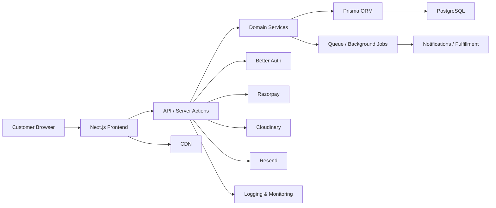
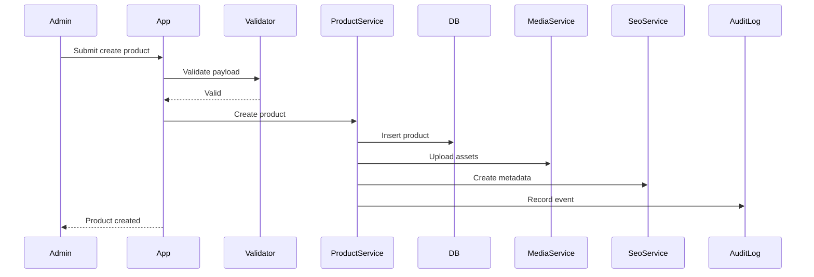

# Bhuvi Naturals – Production Architecture Specification

Date: 2026-07-09

Status: Draft for Engineering Implementation

## 1. Purpose

This document defines the production-grade architecture for the Bhuvi Naturals ecommerce platform. It is intended for senior engineers, architects, DevOps engineers, and technical leads. The architecture is designed to support a small initial launch while remaining suitable for significant growth to one million users.

The architecture is based on approved product requirements, UX architecture, and design system decisions. It does not re-define product goals or UI strategy.

---

# PART 1 — System Architecture

## 1.1 Architectural Goals

The architecture must support:

- premium storefront performance and SEO,
- secure commerce workflows,
- strong operational visibility,
- future growth across content, subscriptions, and internationalization,
- a small efficient team at launch and long-term maintainability.

## 1.2 Core Architectural Principles

- Prefer managed services over self-hosted infrastructure wherever appropriate.
- Keep the system modular and feature-oriented.
- Separate public-facing storefront concerns from admin operations.
- Use server-rendered and statically generated routes for public SEO paths.
- Keep business logic in services rather than in UI or API handlers.
- Make observability and security first-class concerns.

## 1.3 High-Level Architecture

### Frontend

- Next.js 16 App Router for customer storefront, marketing pages, blog, auth, and admin shell.
- React 19 for component rendering.
- Tailwind CSS v4 and Shadcn UI for consistent, scalable UI primitives.
- Framer Motion for carefully scoped motion.
- TanStack Query for client-side data fetching and caching.
- React Hook Form and Zod for form handling and validation.

### Backend

- Server-side application logic executed through Next.js server components, server actions, and route handlers.
- Business services for catalog, cart, checkout, orders, inventory, payments, reviews, SEO, CMS, auth, and notifications.
- Prisma ORM for schema management and data access.

### Data Layer

- PostgreSQL as the primary transactional database.
- Prisma migrations and schema management.
- Cloudinary for media asset hosting.

### Integrations

- Better Auth for authentication and session management.
- Razorpay for payments and webhook-driven status updates.
- Resend for transactional email.
- Vercel for hosting and deployment.
- GitHub Actions for CI/CD.

### Infrastructure and Operations

- Vercel hosting for frontend and server runtime.
- Managed PostgreSQL.
- CDN for static assets and media.
- Logging, metrics, traces, monitoring, alerting, and health checks.

## 1.4 Architecture Diagram



## 1.5 Connection Explanation

- Customer browser requests are handled by the Next.js frontend and served through Vercel.
- The frontend uses server-rendered pages and API/server actions for dynamic operations.
- Domain services encapsulate business rules for products, inventory, orders, payments, and content.
- Prisma connects the application layer to PostgreSQL.
- Better Auth handles session and authentication concerns.
- Razorpay handles payments and sends webhooks back to the platform.
- Cloudinary stores and serves product and marketing media via CDN.
- Resend handles transactional email.
- Logs and metrics flow to observability services for monitoring and debugging.
- Background jobs handle asynchronous work such as order notifications and inventory reconciliation.

## 1.6 Architecture Decision Summary

### Problem

The platform must support both public storefront commerce and internal operations without coupling them tightly.

### Decision

Use a modular Next.js application with server-rendered storefront pages, server actions for mutations, and a clear service layer over Prisma and external integrations.

### Reasoning

This provides strong SEO, performance, developer productivity, and scalable growth while avoiding over-engineering at launch.

### Advantages

- strong SEO and static performance,
- maintainable domain boundaries,
- clear separation between UI and business logic,
- easy future scaling.

### Disadvantages

- requires disciplined architecture and team conventions.
- server/client rendering boundaries must be managed carefully.

### Trade-offs

The architecture prioritizes long-term maintainability and scalability over maximum initial simplicity.

### Future Considerations

Introduce dedicated backend services and queue infrastructure as the platform grows beyond a single-app deployment model.

---

# PART 2 — Folder Structure

## 2.1 Folder Structure Principles

The repository should reflect enterprise-grade clarity:

- application layer for route and UI composition,
- features for user-facing capabilities,
- entities for core domain models,
- widgets for composite UI units,
- shared for reusable infrastructure and primitives,
- infrastructure for integrations and external concerns,
- config for environment and tooling,
- database for schema and migrations,
- API for contracts and endpoints,
- types and utilities for reuse.

## 2.2 Proposed Folder Structure

```text
src/
  app/
    (marketing)/
    (shop)/
    (auth)/
    admin/
    api/
    globals.css
    layout.tsx
    not-found.tsx
    error.tsx

  application/
    layouts/
    providers/
    shells/
    containers/

  features/
    auth/
    catalog/
    cart/
    checkout/
    orders/
    inventory/
    payments/
    reviews/
    wishlist/
    coupons/
    addresses/
    media/
    cms/
    blog/
    analytics/
    seo/
    settings/
    notifications/
    shipping/
    tracking/

  entities/
    user/
    product/
    variant/
    category/
    collection/
    order/
    payment/
    inventory/
    review/
    coupon/
    address/
    media/
    content/
    seo/

  widgets/
    navbar/
    footer/
    product-gallery/
    cart-drawer/
    sticky-add-to-cart/
    checkout-stepper/
    order-timeline/
    analytics-card/

  shared/
    ui/
    components/
    hooks/
    utils/
    lib/
    types/
    constants/
    config/
    assets/
    animations/
    styles/

  infrastructure/
    auth/
    db/
    payments/
    storage/
    email/
    cache/
    logging/
    monitoring/
    search/
    queue/
    analytics/

  config/
    env/
    routes/
    feature-flags/
    i18n/

  database/
    prisma/
    migrations/
    seed/

  api/
    routes/
    contracts/
    validators/
    middlewares/

  types/
    api/
    domain/
    ui/

  hooks/
    use-auth/
    use-cart/
    use-media/
    use-viewport/

  constants/
    routes.ts
    statuses.ts
    currencies.ts
    payments.ts

  assets/
    images/
    icons/
    illustrations/

  providers/
    theme-provider.tsx
    query-provider.tsx
    auth-provider.tsx

  layouts/
    marketing-layout.tsx
    shop-layout.tsx
    auth-layout.tsx
    admin-layout.tsx

  cms/
    editors/
    renderers/
    blocks/

  admin/
    dashboard/
    products/
    inventory/
    orders/
    customers/
    content/
    seo/
    settings/

  customer/
    account/
    orders/
    address-book/
    wishlist/
    subscriptions/

  seo/
    metadata/
    schema/
    sitemap/
    robots/
```

## 2.3 Why Each Folder Exists

### app

Contains route-level application entry points, layouts, global error boundaries, and Next.js app router structure.

### application

Contains page-level composition, shells, providers, and layout containers for the storefront and admin experience.

### features

Contains feature-specific logic and UI by business capability, such as cart, checkout, inventory, and CMS.

### entities

Contains domain models and business entities such as Product, Order, Address, User, and Review.

### widgets

Contains larger UI patterns that assemble many smaller components, such as a sticky add-to-cart bar or analytics dashboard card.

### shared

Contains reusable primitives, hooks, utilities, styles, constants, and common infrastructure needed across features.

### infrastructure

Contains integration-specific logic for auth, database, payments, storage, email, logging, analytics, and search.

### config

Contains environment, routing, feature-flag, and app configuration concerns.

### database

Contains Prisma schemas, migrations, and seed data.

### api

Contains API route conventions, contract schemas, validators, and middleware.

### types

Centralizes TypeScript domain and API types for consistency.

### hooks

Contains reusable hooks for behavior such as auth, cart, viewport awareness, and form handling.

### constants

Stores shared app constants such as route names, payment statuses, and currency definitions.

### assets

Stores icons, illustrations, images, and static assets.

### providers

Contains application-wide providers such as auth, theme, query client, and analytics.

### layouts

Contains layout wrappers for public, customer, auth, and admin experiences.

### cms

Contains content management tooling and rendering logic.

### admin

Contains internal admin pages and operational workflows.

### customer

Contains customer account and post-purchase UIs.

### seo

Contains metadata, schema, sitemap, and robots logic.

---

# PART 3 — Module Architecture

## 3.1 Authentication Module

Responsibilities:

- user registration, login, logout, password reset, email verification, and session handling.

Dependencies:

- Better Auth, Prisma, Resend, environment config.

Public API:

- signUp, signIn, signOut, verifyEmail, resetPassword, getSession.

Internal Logic:

- credential validation, session issuance, password hashing, account recovery tokens.

Future Expansion:

- social login, OTP, SSO, MFA, admin SSO.

## 3.2 Products Module

Responsibilities:

- product CRUD, publishing, variant handling, media assignment, SEO metadata, and content enrichment.

Dependencies:

- Prisma, Cloudinary, SEO metadata services, inventory module.

Public API:

- listProducts, getProductBySlug, createProduct, updateProduct, publishProduct.

Internal Logic:

- validation, pricing rules, category assignment, media relationships, slug generation.

Future Expansion:

- recommendations, bundles, subscriptions, product comparison.

## 3.3 Categories Module

Responsibilities:

- category hierarchy and merchandising association.

Dependencies:

- Prisma, SEO metadata, products module.

Public API:

- listCategories, getCategory, createCategory, updateCategory.

Future Expansion:

- nested navigation, dynamic landing pages.

## 3.4 Inventory Module

Responsibilities:

- stock management, reservation, release, stock movement tracking, low-stock alerts.

Dependencies:

- Prisma, orders module, payments module.

Public API:

- getStockLevel, reserveStock, releaseReservation, adjustStock.

Internal Logic:

- transaction-safe reservation and stock movement rules.

Future Expansion:

- multi-location and warehouse support.

## 3.5 Orders Module

Responsibilities:

- create, update, track, fulfill, cancel, refund, and report on orders.

Dependencies:

- inventory, payments, shipping, notifications, addresses.

Public API:

- createOrder, getOrder, updateOrderStatus, cancelOrder, refundOrder.

Internal Logic:

- status transitions, order total calculations, support integration.

Future Expansion:

- backorder workflows, split shipments, partial refunds.

## 3.6 Payments Module

Responsibilities:

- initiate payments, process webhooks, confirm payment status, manage refunds, and maintain audit state.

Dependencies:

- Razorpay, orders module, Prisma.

Public API:

- initiatePayment, confirmPayment, refundPayment.

Internal Logic:

- signature verification, idempotency, reconciliation.

Future Expansion:

- wallet support, installments, alternate gateways.

## 3.7 Reviews Module

Responsibilities:

- capture, moderate, and display product reviews.

Dependencies:

- orders module, users, media.

Public API:

- submitReview, listReviews, approveReview, rejectReview.

Future Expansion:

- review media, Q&A, verified purchase badges.

## 3.8 Wishlist Module

Responsibilities:

- save products for later and allow subsequent checkout.

Dependencies:

- products module, auth module.

Public API:

- addToWishlist, removeFromWishlist, listWishlist.

## 3.9 Coupons Module

Responsibilities:

- create, validate, apply, and track coupons.

Dependencies:

- orders module, pricing logic.

Public API:

- validateCoupon, applyCoupon, createCoupon.

Future Expansion:

- tiered discounts, bundle promotions, audience-based offers.

## 3.10 Addresses Module

Responsibilities:

- manage customer delivery and billing addresses.

Dependencies:

- users module.

Public API:

- createAddress, updateAddress, setDefaultAddress.

## 3.11 Media Module

Responsibilities:

- upload, transform, organize, and serve images and other assets.

Dependencies:

- Cloudinary, products module, CMS module.

Public API:

- uploadMedia, getMediaUrl, deleteMedia.

Future Expansion:

- video optimization, asset tagging, DAM integration.

## 3.12 CMS Module

Responsibilities:

- manage static pages, content blocks, and marketing content.

Dependencies:

- Prisma, media module, SEO module.

Public API:

- createPage, updatePage, publishPage.

## 3.13 Blog Module

Responsibilities:

- manage editorial content, categories, and publishing.

Dependencies:

- CMS module, SEO module, media module.

Public API:

- createPost, updatePost, publishPost, listPosts.

## 3.14 Analytics Module

Responsibilities:

- collect and expose ecommerce and product usage insights.

Dependencies:

- orders, products, reviews, auth, event ingestion.

Public API:

- getDashboardMetrics, getConversionReports.

## 3.15 SEO Module

Responsibilities:

- metadata management, structured data, canonical routing, sitemap, and redirect logic.

Dependencies:

- products, categories, content, CMS.

Public API:

- updateSeoMeta, generateSitemap, getSeoData.

## 3.16 Settings Module

Responsibilities:

- global storefront preferences, feature flags, payment settings, and operational configuration.

Dependencies:

- Prisma, environment config.

## 3.17 Notifications Module

Responsibilities:

- transactional notifications for orders, support, account recovery, and marketing communications.

Dependencies:

- Resend, queue system, orders module.

## 3.18 Shipping and Tracking Module

Responsibilities:

- coordinate fulfillment data, tracking updates, and shipment status.

Dependencies:

- orders module, notifications module.

Future Expansion:

- multi-carrier support, label generation, rate shopping.

---

# PART 4 — Database Architecture

## 4.1 Database Architecture Principles

The database should support:

- transactional integrity,
- clear audit history,
- inventory safety,
- content and SEO flexibility,
- future modular growth.

PostgreSQL is the single source of truth for transactional data. The architecture should be relational and normalized rather than document-oriented.

## 4.2 Core Database Domains

### Identity and Access

- users
- sessions
- accounts
- verification_tokens
- roles
- permissions
- role_permissions
- user_roles

### Customer Data

- customer_profiles
- addresses

### Catalog and Merchandising

- brands
- categories
- collections
- products
- product_variants
- product_media
- tags
- product_tags
- ingredients
- product_ingredients
- product_collections

### Cart and Checkout

- carts
- cart_items
- orders
- order_items
- order_status_history
- payments
- payment_events
- refunds
- shipments

### Inventory

- inventory_levels
- stock_movements
- inventory_reservations

### Promotions

- coupons
- coupon_usages

### Reviews and Community

- reviews

### SEO and CMS

- seo_meta
- pages
- blog_categories
- blog_posts
- faq_entries

### Operations and Governance

- audit_logs
- site_settings
- newsletter_subscribers
- wishlists
- wishlist_items
- subscriptions
- support_tickets

## 4.3 Why Each Table Exists

Every table should be included because it supports a real business or operational capability. The schema should not include redundant or speculative entities.

Examples:

- inventory_reservations exists because stock must be protected during checkout.
- order_status_history exists because support and operations need a full audit trail.
- seo_meta exists because metadata requirements span many content entities and should be consistent.
- audit_logs exists because admin actions must be reviewable and auditable.
- coupons and coupon_usages exist because promotions need validation and abuse prevention.

## 4.4 Relationships

The relationships are designed to preserve data integrity and keep business logic straightforward.

Examples:

- products -> product_variants -> inventory_levels
- orders -> order_items -> products
- orders -> payments -> payment_events
- users -> addresses -> orders
- products -> reviews -> users
- pages/blog posts -> seo_meta

## 4.5 Indexing Strategy

High-value indexes include:

- users.email
- products.slug
- product_variants.sku
- orders.order_number
- inventory_levels.product_variant_id
- cart_items.cart_id and product_variant_id
- reviews.product_id and status
- seo_meta.entity_type and entity_id
- audit_logs.created_at

## 4.6 Constraints

Use:

- unique constraints for email, slug, SKU, order number, coupon code,
- check constraints for quantity, rating, price, and status values,
- foreign keys for relational integrity,
- non-null constraints for required transactional fields.

## 4.7 Normalization Strategy

The schema follows relational normalization for core transactional data and uses controlled denormalization only where it improves read performance for high-frequency pages.

## 4.8 Soft Deletes

Soft deletes should be used for business records that must preserve history, including:

- products,
- categories,
- coupons,
- reviews,
- blog posts,
- pages,
- orders,
- addresses,
- support tickets.

## 4.9 Audit Logs

Every significant operational change should be recorded, including:

- product changes,
- inventory updates,
- order status changes,
- payment events,
- coupon changes,
- content publishing,
- admin role changes.

## 4.10 Versioning

Versioning is recommended for:

- content pages,
- blog posts,
- product descriptions,
- SEO metadata,
- promotion rules.

A lightweight version table or revision table can be introduced later if editorial workflows grow.

## 4.11 Inventory Strategy

Inventory is managed at the variant level and uses the following pattern:

1. stock exists in inventory_levels,
2. checkout reserves stock in inventory_reservations,
3. payment confirmation converts reservation into committed stock,
4. stock movements record every change.

This strategy prevents overselling and preserves audit history.

## 4.12 Stock Reservation Strategy

Reserved stock should expire after a defined window if payment is not completed. The reservation mechanism keeps checkout safe and prevents overselling at scale.

## 4.13 Coupon Strategy

Coupons should be stored as rules with integrity constraints and usage logging through coupon_usages. This prevents abuse and supports reporting.

## 4.14 Review Strategy

Reviews should be stored separately from order data and moderated using a status workflow. This supports trust and product transparency while allowing future moderation automation.

## 4.15 SEO Strategy

SEO metadata should be stored in a shared seo_meta table to keep metadata management consistent across products, categories, collections, blog posts, and pages.

## 4.16 CMS Strategy

CMS content should be versioned and published state-managed. The system should not rely on direct database edits for content operations.

---

# PART 5 — API Architecture

## 5.1 API Principles

- Use RESTful APIs for predictable resource access.
- Version APIs from the start via /api/v1.
- Validate inputs and return consistent error structures.
- Use strong typing and shared contracts.
- Apply rate limiting and auth middleware globally.

## 5.2 API Standards

### Common Response Shape

```json
{
  "data": {},
  "meta": {
    "page": 1,
    "pageSize": 20,
    "total": 100
  },
  "errors": []
}
```

### Common Error Shape

```json
{
  "error": {
    "code": "VALIDATION_ERROR",
    "message": "One or more fields are invalid",
    "details": []
  }
}
```

## 5.3 API Documentation Reference

### Authentication

- POST /api/v1/auth/signup
- POST /api/v1/auth/login
- POST /api/v1/auth/logout
- POST /api/v1/auth/forgot-password
- POST /api/v1/auth/verify-email
- GET /api/v1/auth/session

### Products

- GET /api/v1/products
- GET /api/v1/products/:id
- POST /api/v1/admin/products
- PATCH /api/v1/admin/products/:id
- DELETE /api/v1/admin/products/:id

### Categories

- GET /api/v1/categories
- GET /api/v1/categories/:slug

### Cart

- GET /api/v1/cart
- POST /api/v1/cart/items
- PATCH /api/v1/cart/items/:id
- DELETE /api/v1/cart/items/:id

### Checkout

- POST /api/v1/checkout
- POST /api/v1/checkout/confirm

### Orders

- GET /api/v1/orders
- GET /api/v1/orders/:id
- PATCH /api/v1/admin/orders/:id/status

### Payments

- POST /api/v1/payments/initiate
- POST /api/v1/webhooks/razorpay

### Reviews

- GET /api/v1/products/:id/reviews
- POST /api/v1/reviews

### Coupons

- GET /api/v1/coupons/validate
- POST /api/v1/admin/coupons

### Media

- POST /api/v1/media/upload

### CMS / Blog

- GET /api/v1/pages/:slug
- GET /api/v1/blog/posts
- POST /api/v1/admin/blog/posts

## 5.4 Route Design Notes

- Public storefront routes should be read-oriented and cache-friendly.
- Mutations should be authenticated or authorized.
- Admin routes should be separated from customer routes for clearer authorization contracts.

## 5.5 Method and Status Expectations

- GET: 200 or 404
- POST: 201 or 400/409/422
- PATCH: 200 or 400/404
- DELETE: 204 or 404
- Unauthorized: 401
- Forbidden: 403
- Rate limited: 429

## 5.6 Validation

Use Zod schemas for request validation at the API boundary.

## 5.7 Authorization

Each route must be protected by middleware that checks authentication and role permissions.

## 5.8 Rate Limiting

Rate limit sensitive endpoints such as:

- login,
- signup,
- password resets,
- checkout,
- payment initiation,
- admin mutations.

## 5.9 Pagination

Support page and pageSize with default values and max limits.

## 5.10 Filtering and Sorting

Support common filters such as:

- category,
- price,
- stock status,
- availability,
- active status,
- created date.

## 5.11 Searching

Support search for products, orders, customers, content, and media.

## 5.12 Versioning

Version the API from the beginning. Future changes should not break existing clients.

---

# PART 6 — Authentication Architecture

## 6.1 Authentication Goals

- secure customer accounts,
- support admin workflows,
- support session management with low operational complexity,
- allow future growth into social login or MFA.

## 6.2 Authentication Flow

### Signup

1. User submits email, password, and optional profile data.
2. Validation occurs.
3. Account created with verification token.
4. Verification email sent.
5. User verifies email and becomes active.

### Login

1. User submits credentials.
2. Auth service validates identity.
3. Session is created.
4. User is redirected to the appropriate route.

### Forgot Password

1. User submits email.
2. Reset token is created.
3. Email with reset link is sent.
4. User sets a new password.

### Email Verification

1. Token generated and stored.
2. Verification email sent.
3. Token is validated and marked used.

### Session Management

- session tokens stored securely in HTTP-only cookies,
- refresh strategy handles token renewal,
- invalidation on logout or password change.

### Role-Based Access

Customers, admins, and managers receive role-based permissions through Better Auth and app-level checks.

### Protected Routes

- account pages,
- order detail pages,
- checkout,
- admin routes,
- content management surfaces.

### Logout

- clear session cookie,
- invalidate server session state.

### Security Considerations

- strong password policy,
- CSRF protection for state-changing requests,
- session expiration,
- secure cookie settings,
- rate limiting on auth endpoints.

---

# PART 7 — Authorization Architecture

## 7.1 RBAC Model

The application will use role-based access control with permission-based enforcement.

### Roles

- Guest
- Customer
- Admin
- Manager
- Inventory Staff
- Content Manager
- Support Agent

## 7.2 Permission Matrix

| Role            | View Products | Manage Products | Manage Inventory | Manage Orders | View Analytics | Manage Content | Manage Coupons | Manage Users |
| --------------- | ------------- | --------------- | ---------------- | ------------- | -------------- | -------------- | -------------- | ------------ |
| Guest           | Yes           | No              | No               | No            | No             | No             | No             | No           |
| Customer        | Yes           | No              | No               | No            | No             | No             | No             | No           |
| Support Agent   | Yes           | No              | No               | Yes           | No             | No             | No             | No           |
| Inventory Staff | Yes           | No              | Yes              | No            | No             | No             | No             | No           |
| Content Manager | Yes           | No              | No               | No            | No             | Yes            | No             | No           |
| Manager         | Yes           | Yes             | Yes              | Yes           | Yes            | Yes            | Yes            | No           |
| Admin           | Yes           | Yes             | Yes              | Yes           | Yes            | Yes            | Yes            | Yes          |

## 7.3 Permission Definitions

- view_products: view catalog and product data
- manage_products: create, edit, publish, archive products
- manage_inventory: update stock and reservations
- manage_orders: change order status and fulfill orders
- view_analytics: access dashboards and reporting
- manage_content: publish blog and static content
- manage_coupons: create and edit promotions
- manage_users: manage admin and staff access

## 7.4 Enforcement Strategy

Authorization checks will happen at:

- route level,
- API layer,
- server actions,
- admin workflow boundaries.

---

# PART 8 — Business Workflows

## 8.1 Product Creation Workflow

### Sequence

1. Admin submits product form.
2. Validation runs.
3. Product is created in database.
4. Media upload is attached.
5. SEO metadata is created.
6. Product becomes draft or published.
7. Audit log is written.

### Diagram



## 8.2 Inventory Update Workflow

### Sequence

1. Admin updates stock.
2. Inventory service validates quantity.
3. Stock movement is recorded.
4. Inventory level updates.
5. Low-stock alert may be triggered.

## 8.3 Order Creation Workflow

### Sequence

1. Customer submits checkout.
2. Cart is validated.
3. Inventory reservation is created.
4. Payment is initiated.
5. Order is created after successful payment or pending completion.
6. Fulfillment workflow begins.

## 8.4 Payment Success Workflow

### Sequence

1. Razorpay confirms payment.
2. Webhook is verified.
3. Order status becomes paid.
4. Inventory reservation is finalized.
5. Notifications are sent.

## 8.5 Payment Failure Workflow

### Sequence

1. Payment attempt fails.
2. Order remains pending or cancelled per policy.
3. Reservation is released.
4. Notification is sent to customer.

## 8.6 Order Cancellation Workflow

### Sequence

1. Admin or system requests cancellation.
2. Eligibility checks run.
3. Stock is released if needed.
4. Refund workflow may begin.
5. Audit log is written.

## 8.7 Refund Workflow

### Sequence

1. Refund request is initiated.
2. Eligibility and amount are validated.
3. Payment gateway refund request is sent.
4. Refund status is tracked.
5. Customer is notified.

## 8.8 Review Approval Workflow

### Sequence

1. Customer writes review.
2. Review is pending moderation.
3. Admin approves or rejects.
4. Published or rejected state is saved.

## 8.9 Coupon Validation Workflow

### Sequence

1. Customer enters coupon.
2. Coupon service validates active status, date range, usage limits, and eligibility.
3. Discount is applied if valid.
4. Coupon usage is recorded on success.

## 8.10 Media Upload Workflow

### Sequence

1. Admin uploads asset.
2. File is validated.
3. Media is uploaded to Cloudinary.
4. Metadata and URL are stored.
5. Product or content references are updated.

## 8.11 Blog Publishing Workflow

### Sequence

1. Editor creates post.
2. Content is validated.
3. SEO metadata is attached.
4. Post is saved as draft or published.
5. Cache and sitemap updates are triggered.

## 8.12 Tracking Update Workflow

### Sequence

1. Carrier updates shipment status.
2. Webhook or feed updates order status.
3. Customer receives tracking update.
4. Order timeline is updated.

---

# PART 9 — Error Handling Strategy

## 9.1 Error Handling Principles

- use typed domain errors,
- never leak sensitive internals,
- return consistent error shapes,
- log with correlation IDs,
- preserve recoverable state where possible.

## 9.2 Error Categories

### Validation Errors

- malformed payload,
- missing required fields,
- invalid status transitions.

### Business Errors

- out-of-stock,
- coupon ineligible,
- payment already processed,
- invalid refund request.

### Server Errors

- unexpected exception,
- database failure,
- third-party integration issue.

### Network Errors

- upstream provider unavailable,
- timeout during payment or email dispatch.

### Payment Errors

- signature failure,
- duplicate callback,
- incomplete payment confirmation.

### Authentication Errors

- invalid credentials,
- session expired,
- unauthorized access.

## 9.3 Error Handling Pattern

- route-level handlers should catch and translate errors,
- services should throw domain-specific errors,
- UI should map errors to user-facing messages,
- retries should be applied only to transient failures.

## 9.4 Logging

All errors should be logged with:

- correlation ID,
- user ID where safe,
- request path,
- environment,
- error type,
- stack trace.

## 9.5 Recovery and Retry

- retries for transient network errors,
- idempotency keys for payment and webhook handling,
- dead-letter handling for queue failures,
- safe rollback or compensation for inventory and payment mismatches.

---

# PART 10 — Performance Architecture

## 10.1 Rendering Strategy

### Server Components

Use server components for:

- marketing pages,
- blog pages,
- product and category pages where SEO matters,
- content-heavy page shells.

### Client Components

Use client components for:

- carts,
- checkout,
- search interactions,
- filters,
- account management,
- admin management workflow.

### Server Actions

Use server actions for:

- checkout submission,
- content publishing,
- inventory updates,
- admin forms,
- password reset workflows.

## 10.2 Caching Strategy

Use:

- CDN caching for static assets,
- ISR for content-rich public pages,
- SSR for personalized or dynamic content,
- route caching for static collection and marketing pages,
- query caching for product listing and content reads.

## 10.3 Streaming

Use streaming for large content pages and dashboards to improve perceived performance.

## 10.4 Lazy Loading

Use lazy loading for:

- product gallery images,
- blog images,
- admin charts,
- analytics modules.

## 10.5 Image Optimization

Use Cloudinary image transformations with responsive variants and lazy loading.

## 10.6 Bundle Splitting

Split bundles by route and feature to keep each page lean.

## 10.7 Database Optimization

- use indexes for frequent access paths,
- avoid N+1 query patterns,
- use pagination and projections,
- optimize inventory and order queries carefully.

## 10.8 API Optimization

- avoid over-fetching,
- use pagination and filtering,
- return only necessary fields,
- support partial responses where necessary.

## 10.9 Core Web Vitals

Targets:

- LCP < 2.5s on the main storefront paths,
- INP < 200ms for interactive flows,
- CLS < 0.1.

---

# PART 11 — Security Architecture

## 11.1 Security Principles

- assume public internet exposure,
- treat secrets as sensitive runtime values,
- authenticate every privileged action,
- validate inputs at every boundary,
- protect third-party webhooks.

## 11.2 OWASP Considerations

The system should address:

- XSS,
- CSRF,
- SQL injection,
- broken authentication,
- broken access control,
- sensitive data exposure,
- security misconfiguration,
- vulnerable dependencies.

## 11.3 XSS

- sanitize and encode all user-generated content,
- avoid unsafe HTML rendering,
- use secure content rendering patterns for CMS content.

## 11.4 CSRF

- protect state-changing requests with CSRF tokens where required.

## 11.5 SQL Injection

- use Prisma parameterized queries,
- avoid raw SQL except where strictly necessary.

## 11.6 Authentication Security

- secure session cookies,
- MFA for admin users,
- strong password policy,
- lockout or rate limiting on repeated login attempts.

## 11.7 Authorization Security

- enforce access at route, API, and service boundaries,
- avoid privilege escalation by design,
- keep permissions explicit and reviewed.

## 11.8 Headers

Use standard production headers such as:

- Content-Security-Policy,
- Strict-Transport-Security,
- X-Content-Type-Options,
- Referrer-Policy,
- X-Frame-Options.

## 11.9 Rate Limiting

Protect auth, checkout, payment, and admin endpoints using rate limiting.

## 11.10 Secrets Management

- use environment variables securely,
- rotate secrets regularly,
- avoid secrets in source control.

## 11.11 Input Validation

Validate all API and form payloads using Zod at the boundary.

## 11.12 File Upload Security

- validate type and size,
- scan uploads if necessary,
- store user uploads in managed storage.

## 11.13 Payment Security

- verify Razorpay signatures,
- use idempotency for webhooks,
- do not expose payment secrets to the client.

---

# PART 12 — Observability Architecture

## 12.1 Logging

Use structured logging with correlation IDs. Logs should capture:

- request ID,
- user ID if safe,
- route and action,
- outcome,
- latency,
- error type.

## 12.2 Monitoring

Monitor:

- API latency,
- error rates,
- database health,
- payment failure rates,
- checkout success rate,
- inventory discrepancies,
- deployment health.

## 12.3 Health Checks

Expose health check endpoints for:

- app availability,
- database connectivity,
- payment integration status,
- storage service availability.

## 12.4 Metrics

Collect metrics for:

- traffic,
- conversion,
- requests per minute,
- error count,
- response time,
- queue length,
- stock movement volume.

## 12.5 Alerts

Alert on:

- elevated error rates,
- payment webhook failures,
- database connection issues,
- deployment failures,
- abnormal inventory discrepancies.

## 12.6 Tracing

Use request tracing across frontend, API, and background jobs where practical.

## 12.7 Audit Logs

Audit logs should capture:

- admin product changes,
- inventory adjustments,
- order state changes,
- coupon edits,
- content publishing.

---

# PART 13 — Deployment Architecture

## 13.1 Environment Model

- Development
- Staging
- Production

## 13.2 Deployment Platform

Vercel will host the frontend and server runtime. PostgreSQL will be managed separately. Background jobs and worker processes will be run using a queue-compatible environment or Vercel-compatible worker setup.

## 13.3 Environment Variables

Use environment variables for:

- database connection,
- auth secrets,
- payment gateway credentials,
- Cloudinary keys,
- email provider credentials,
- analytics keys,
- feature flags.

## 13.4 CI/CD

Use GitHub Actions for:

- linting,
- type checking,
- tests,
- build verification,
- deployment to staging and production.

## 13.5 Rollback

Each release must support quick rollback through:

- deployment history,
- feature flags,
- database-safe migrations,
- rollback scripts where necessary.

## 13.6 Database Migrations

All schema changes should go through Prisma migrations and be validated in staging before production.

## 13.7 Backups

- automated database backups,
- point-in-time restore where supported,
- tested restore procedures,
- backup retention policy.

---

# PART 14 — Engineering Standards

## 14.1 Naming Conventions

- use clear, descriptive names,
- use camelCase for variables and functions,
- use PascalCase for components and types,
- use kebab-case for file paths and routes,
- use UPPER_SNAKE_CASE for environment variables and constants.

## 14.2 Git Strategy

- trunk-based development for small teams with feature branches for larger work.
- short-lived branches for isolated changes.

## 14.3 Commit Convention

Use clear conventional commit messages such as:

- feat: add cart drawer
- fix: fix inventory reservation bug
- docs: update architecture notes

## 14.4 Branch Strategy

- main for production-ready code,
- develop or staging for pre-production integration,
- feature branches for implementation work.

## 14.5 PR Guidelines

Every PR should include:

- purpose,
- scope,
- testing notes,
- screenshots or recordings where relevant,
- comments on risk or rollout impact.

## 14.6 Code Review Checklist

- correctness,
- security concerns,
- performance implications,
- test coverage,
- accessibility,
- documentation updates.

## 14.7 Testing Strategy

Use:

- unit tests for utilities and services,
- integration tests for API and business flows,
- end-to-end tests for critical journeys such as checkout and admin login,
- contract tests for third-party integrations.

## 14.8 Documentation Standards

Each significant module should include:

- purpose,
- responsibilities,
- public contracts,
- operational notes,
- ownership.

---

# PART 15 — Scalability Roadmap

## 15.1 10 Users

Current architecture is sufficient.

### Focus

- establish solid conventions,
- get core commerce flows working,
- confirm observability and deployment process.

## 15.2 100 Users

### Required Changes

- add monitoring and alerting rigor,
- optimize database queries,
- improve caching,
- add background job handling for notifications and processing tasks.

## 15.3 1,000 Users

### Required Changes

- add more robust queue infrastructure,
- separate read-heavy workloads where needed,
- improve admin and analytics performance,
- monitor third-party integration reliability.

## 15.4 10,000 Users

### Required Changes

- consider dedicated worker services,
- introduce more advanced caching and edge strategies,
- improve database indexing and query design,
- strengthen backup, recovery, and incident response.

## 15.5 100,000 Users

### Required Changes

- evaluate service decomposition for high-volume domains,
- introduce more advanced observability and tracing,
- implement stronger queue and event-driven architecture,
- add regional or multi-zone resilience if necessary.

## 15.6 1 Million Users

### Required Changes

- horizontal scaling of stateless layers,
- separate critical domains into services if needed,
- advanced caching, edge deployment, and regional distribution,
- database sharding or partitioning strategies where necessary,
- more mature incident management and disaster recovery.

---

# Final Architectural Summary

The Bhuvi Naturals architecture is designed as a modular, production-grade platform that can start lean and grow to large scale. The system combines Next.js, React, TypeScript, PostgreSQL, Prisma, Better Auth, Razorpay, Cloudinary, Resend, and Vercel in a way that supports SEO, commerce, content, security, observability, and maintainability. It is structured for multiple engineers to begin implementation immediately while remaining adaptable to future scale and complexity.
